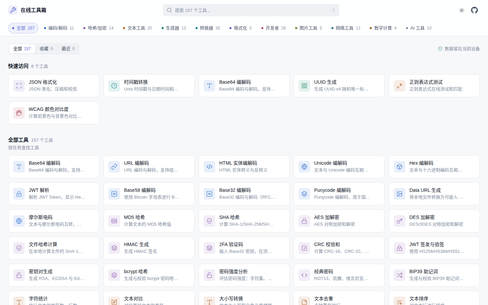
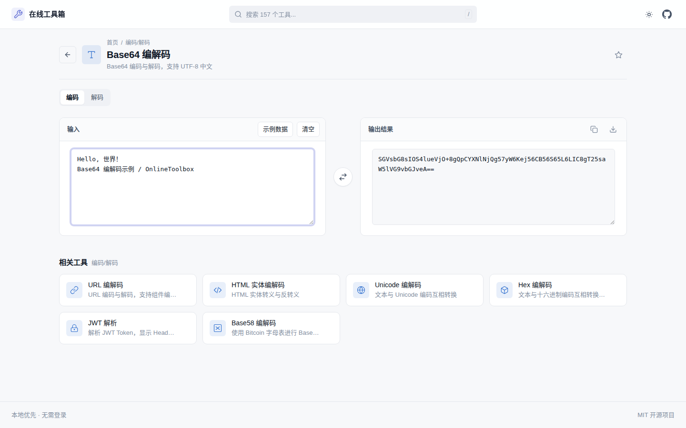
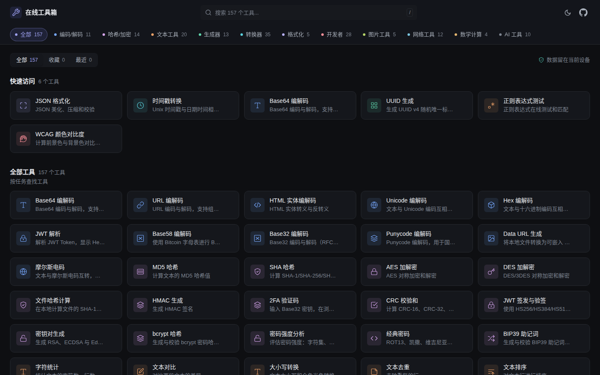
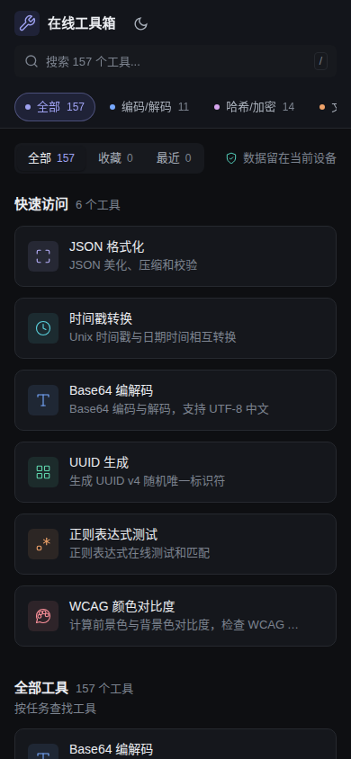

# 🛠️ 在线工具箱

一个纯静态、轻量级的在线开发者工具箱，提供 180 个常用编解码、文本处理、格式化、生成器、转换器、AI 辅助等实用工具。无需账号或后端服务，绝大多数数据只在浏览器本地处理。

**在线访问：[tools.xiaoxura.com](https://tools.xiaoxura.com/)** · [MIT License](./LICENSE) · [CI](https://github.com/xiaoxura/OnlineToolbox/actions/workflows/ci.yml)

## 📸 界面预览

<p align="center">
  <a href="https://tools.xiaoxura.com/">
    
  </a>
</p>

<p align="center">
  <a href="https://tools.xiaoxura.com/#/base64">
    
  </a>
</p>

| 深色主题 | 移动端 |
| :---: | :---: |
|  |  |

## ✨ 特性

- **180 个实用工具** — 覆盖编码解码、哈希加密、文本处理、生成器、格式化、转换器、开发者参考、图片处理、网络工具、数学计算、AI 工具等 11 大分类
- **工具按需加载** — 首页只加载工具元数据，进入工具后再下载对应实现及依赖；首屏约 50KB gzip
- **纯静态部署** — 构建产物可部署到 EdgeOne Pages、GitHub Pages、Vercel、Netlify 等静态托管平台
- **本地优先与隐私提示** — 绝大多数功能完全在本地运行；IP 查询仅在用户主动点击后请求第三方服务
- **SEO 友好** — 构建时为每个工具和分类生成独立静态落地页，并生成 `sitemap.xml` 与 `robots.txt`
- **可离线使用** — Service Worker 缓存应用外壳，并在后台预缓存全部小体积工具 chunk；断网后未打开过的工具也能使用
- **可分享的筛选状态** — 搜索词、分类与视图写入 URL（`?q=` / `?category=` / `?view=`），刷新与分享后仍能还原
- **深浅色主题** — 支持手动切换、偏好持久化及跟随系统主题
- **响应式与无障碍** — 适配桌面端和移动端，提供语义化结构、表单标签、键盘操作和焦点样式
- **即时搜索与分类导航** — 支持按工具名称、描述、关键词与拼音（`sjc` → 时间戳）快速筛选，并对拼写错误给出纠错建议
- **命令面板与草稿** — 任意页面按 Ctrl/⌘+K 切换工具；输入内容按标签页自动保存，刷新不丢失（密钥类工具除外）
- **结果串联** — 结果工具栏可把输出直接发送到另一个工具作为输入，并自动接收
- **一键复制** — 常用结果支持复制到剪贴板
- **可维护的元数据** — `registry.js` 是唯一的工具元数据源，工具模块只实现 `render()`；`dom.js` 与入口逻辑已按职责拆分

## 🆕 最近更新（2026-10）

本次按 [review.md 落地记录](./docs/review-implementation.md) 完成了一轮体验与架构升级：

- **新增 23 个工具**：JS/TS、YAML、TOML 格式化，Nginx 配置，crontab ↔ systemd，JSON Schema 校验，X.509 证书解析，二维码识别，图片裁剪/旋转/水印，图片取色，SVG 转换，SQL ↔ JSON/CSV，CSV/JSON 表格查看器，UTF-8 字节截断，简繁转换，中文转拼音，Cubic Bezier 缓动，CSS clamp()，Embedding 成本，上下文窗口可视化，SSE 解析，Prompt 安全检查。
- **离线更完整**：构建哈希版本与资产清单，后台预缓存全部小体积 chunk，未访问过的工具也能离线打开；每次部署自动清理过期缓存。
- **输入不再丢**：工具草稿按标签页自动保存/恢复（密钥、密码类工具默认关闭）。
- **搜索与切换更快**：支持拼音/首字母与拼写纠错搜索；任意页面按 Ctrl/⌘+K 打开命令面板。
- **工具可串联**：结果工具栏可把输出直接发送到另一个工具作为输入。
- **技术债清理**：移除停止维护的 crypto-js，格式化器改为按需加载 sql-formatter / Prettier，文件哈希支持分块与 Worker。

## 🧰 工具列表

<!-- TOOLS:START -->
### 编码/解码（11 个）
Base64 编解码 · URL 编解码 · HTML 实体编解码 · Unicode 编解码 · Hex 编解码 · JWT 解析 · Base58 编解码 · Base32 编解码 · Punycode 编解码 · Data URL 生成 · 摩尔斯电码

### 哈希/加密（15 个）
MD5 哈希 · SHA 哈希 · AES 加解密 · DES 加解密 · 文件哈希计算 · HMAC 生成 · 2FA 验证码 · CRC 校验和 · JWT 签发与验签 · 密钥对生成 · bcrypt 哈希 · 密码强度分析 · 经典密码 · BIP39 助记词 · X.509 证书解析

### 文本工具（23 个）
字符统计 · 文本对比 · 大小写转换 · 文本去重 · 文本排序 · 正则表达式测试 · 文本替换 · 转义工具 · Markdown 预览 · 文本集合运算 · 文本加密 · Slug 生成器 · 换行符转换 · 文本自动换行 · Markdown 表格生成 · 词频统计 · 文本提取器 · 隐藏字符检测 · 文本脱敏 · 列表工具 · UTF-8 字节截断 · 简繁转换 · 中文转拼音

### 生成器（15 个）
UUID 生成 · 随机密码生成 · 随机数生成 · Lorem ipsum 生成 · 二维码生成 · 占位图生成 · CSS 渐变生成器 · CSS 阴影生成器 · 调色板生成 · ULID 生成 · UUID 生成与解析 · 条形码生成 · WiFi 二维码 · Cubic Bezier 缓动编辑器 · CSS clamp() 字号生成

### 转换器（37 个）
时间戳转换 · 进制转换 · 颜色转换 · 单位转换 · JSON ↔ YAML 转换 · CPA ↔ Sub2API 凭证转换 · TOML ↔ JSON 转换 · JSON ↔ XML 转换 · JSON 转 CSV · CSV 转 JSON · JSONPath 查询 · Markdown 转 HTML · HTML 转 JSX · CSS 转 JS 对象 · JSON 对比 · 时区转换 · 日期计算器 · JSON 转 TypeScript · 中文大写金额 · 正则表达式可视化 · HTML 转 Markdown · Markdown 目录生成 · CSV 工具箱 · JSON 转代码 · JSON 扁平化 · JSON 键排序 · MongoDB ObjectId · 数字转英文 · 农历 ↔ 公历 · IEEE 754 浮点数 · JSONL ↔ JSON 转换 · JSON Pointer 查询 · JSON Patch 生成 · 时间长度转换 · 数字格式化 · SQL ↔ JSON / CSV · CSV / JSON 表格查看器

### 格式化（8 个）
JSON 格式化 · CSS 格式化 · HTML 格式化 · SQL 格式化 · XML 格式化 · JavaScript / TypeScript 格式化 · YAML 格式化与校验 · TOML 格式化与校验

### 开发者（32 个）
Cron 表达式解析 · HTTP 状态码查询 · User-Agent 解析 · 正则表达式速查表 · CSS 单位转换 · JSON Schema 生成 · Mock 数据生成 · Git 命令速查 · Linux 命令速查 · 身份证号校验 · 银行卡号校验 · 统一社会信用代码校验 · chmod 权限计算器 · SQL IN 参数生成 · 格式校验工具 · WCAG 颜色对比度 · SemVer 版本比较 · MIME 类型查询 · .env ↔ JSON · .properties ↔ JSON · 数据库连接串 · htpasswd 生成器 · IBAN 校验 · Docker Run ↔ Compose · .gitignore 生成器 · Cron 表达式构建器 · CSP 生成器 · XPath 测试器 · Nginx 配置生成器 · crontab ↔ systemd 定时器 · JSON Schema 校验 · Open Graph 标签生成

### 图片工具（9 个）
图片压缩与格式转换 · 图片转 Base64 · SVG 压缩 · Favicon 生成 · 图片 EXIF · 二维码识别 · 图片裁剪、旋转与水印 · 图片取色与主色调 · SVG 转 PNG / JSX / Data URI

### 网络工具（12 个）
IP 地址信息 · 端口说明查询 · URL 解析器 · HTTP Headers 解析 · IPv4/CIDR 计算器 · IPv6 地址解析 · CURL 命令生成器 · URL 参数编辑器 · Cookie / Set-Cookie 解析 · Query String 转换 · URL 去毒化 · UTM 链接构建器

### 数学计算（4 个）
科学计算器 · 大数计算器 · 百分比计算器 · 统计计算器

### AI 工具（14 个）
Token 计数器 · 大模型成本估算 · 大模型对照表 · Prompt 模板填充 · 对话消息组装器 · 对话格式互转 · Function Schema 生成 · LLM 输出 JSON 修复 · 文本分块器 · 向量相似度计算 · Embedding 维度与成本 · 上下文窗口可视化 · SSE 流式响应解析 · System Prompt 安全检查
<!-- TOOLS:END -->

> 这一组全部离线运行：不会向任何模型服务发起请求，也不保存 API Key。Token 计数与按 token 分块使用 `gpt-tokenizer` 的真实 BPE 词表，词表作为静态资源按需下载（`o200k_base` 约 1.0 MB gzip、`cl100k_base` 约 440 KB gzip），只在首次使用时加载。模型价格与上下文窗口为官方标价的参考值（读取于 2026-09-15），厂商调价后可在成本估算器中手动修改单价。

## 🚀 快速开始

### 环境要求

- Node.js >= 20.19 或 >= 22.12
- npm >= 9

### 安装与开发

```bash
npm install
npm run dev
```

访问 <http://localhost:3000> 预览。

### 构建生产版本

```bash
npm run build
```

构建产物输出到 `dist/`。除 Vite 应用资源外，构建脚本还会生成：

- `dist/tools/{tool-id}/index.html`：180 个工具的独立 SEO 落地页
- `dist/tools/{tool-id}/og.png`：每个工具的社交分享卡片（1200×630）
- `dist/categories/{category-id}/index.html`：11 个分类落地页（含分类 OG 卡片）
- `dist/sw.js`：注入构建哈希的离线缓存脚本
- `dist/asset-manifest.json`：本次构建的 chunk 清单与预缓存标记
- `dist/icons/`：PWA 图标
- `dist/og.png`：首页分享卡片
- `dist/sitemap.xml`：首页、分类页及全部工具页的网站地图
- `dist/robots.txt`：爬虫规则、AI 爬虫策略和网站地图地址
- `dist/llms.txt` / `dist/llms-full.txt`：供生成式 AI 引擎读取的工具索引

默认 SEO 站点地址为 `https://tools.xiaoxura.com/`。部署到其他域名或子路径时，通过 `SITE_URL` 覆盖为完整公开地址：

```bash
SITE_URL=https://example.com/ npm run build
# 子目录部署示例：SITE_URL=https://example.com/toolbox/ npm run build
```

该地址会用于 canonical、Open Graph、Schema.org、sitemap 和 robots 元数据。

### 代码检查与测试

```bash
npm run lint          # ESLint 静态检查
npm test              # Vitest 单次测试
npm run test:watch    # Vitest 监听模式
npm run test:coverage # 覆盖率报告（阈值：语句 82%、分支 70%、函数 82%、行 85%）
npm run check         # lint + README/搜索索引/价格数据检查 + 覆盖率测试 + 生产构建
npm run verify:build  # 校验落地页数量、sitemap 与包体积预算
npm run test:e2e      # Playwright 真实浏览器冒烟测试（使用本机 Chrome）
npm run readme        # 根据注册表重新生成 README 工具列表
npm run search:index  # 生成拼音搜索索引（构建前需与注册表同步）
npm run data:check    # 检查大模型/Embedding 价格数据是否过期
npm run icons         # 从 public/favicon.svg 重新生成 PWA 图标
npm run format        # Prettier 格式化
```

当前基线：62 个测试文件 / 1252 个测试，另有 9 个 Playwright 真实浏览器用例。覆盖工具注册表、全部 180 个工具的渲染冒烟测试、表单可访问名称、核心工具行为、Markdown XSS 防护、路由懒加载、URL 筛选状态、工具销毁回调和主题偏好持久化。

## 🔍 SEO 与 GEO

站点同时面向传统搜索引擎（SEO）和生成式 AI 引擎（GEO，即让 ChatGPT、Perplexity、AI Overviews 等能够检索并引用本站内容）做了优化。

**落地页内容由实现推导，而非手写。** 构建时会在 jsdom 中真实渲染每一个工具，读取它自己的区块标题、输入标签、按钮文案、下拉选项与开关（`scripts/tool-facts.mjs`），据此生成该工具的用途说明、使用步骤、可配置选项表和常见问题。所以：

- 页面描述的是真实实现，不是模板复读——每个工具的分隔符选项、按钮名称、输出区块都来自代码本身。
- 给工具加一个选项，它的落地页会在下次构建时自动更新，不会和实现脱节。
- 「是否需要联网」不是写死的文案：构建脚本会扫描工具源码中的 `fetch` / `XMLHttpRequest` / `sendBeacon`，只有确实发起请求的工具才会出现联网提示（当前仅「IP 地址信息查询」）。

**结构化数据**：每个工具页输出 `SoftwareApplication`、`BreadcrumbList` 和 `FAQPage` 三段 JSON-LD；每个分类页输出 `CollectionPage`、`ItemList`、`BreadcrumbList` 和 `FAQPage`；首页输出 `WebSite`（含已实现的 `SearchAction`）、`ItemList` 和 `FAQPage`。工具页之间通过「同类工具」相互链接，工具页的面包屑会指向所属分类页，避免出现孤立页面。

**`llms.txt` 与 `llms-full.txt`**：`llms.txt` 是按分类组织的全量工具索引，`llms-full.txt` 额外包含每个工具的用途、输入输出、选项与联网说明。两者都在构建时生成。

**`sitemap.xml` 的 `lastmod` 与内容挂钩**：构建脚本对每个落地页取内容哈希并记录在 `.seo-manifest.json`（需提交到仓库）。只有页面内容真正变化时才更新该页的 `lastmod`，未变化的页面保持原值——否则每次构建都宣称全站更新，搜索引擎会逐渐忽略这个信号。

**爬虫策略**：`robots.txt` 显式放行 GPTBot、ClaudeBot、PerplexityBot、Google-Extended 等 AI 爬虫。本站的目标是被检索和引用，因此不屏蔽生成式引擎。

## 🔒 隐私与联网说明

除 IP 地址信息查询外，工具输入默认只在当前浏览器内处理，不会上传到项目服务器。

IP 查询采用用户主动触发、超时取消和失败回退机制：

- 公网 IP：优先 `api64.ipify.org`，失败后回退到 `api.ipify.org`
- IP 地理信息：优先 `ipapi.co`，失败后回退到 `ipwho.is`

使用 IP 查询即表示浏览器会直接请求相应第三方服务，相关数据处理受第三方服务隐私政策约束。

## 📦 部署

### EdgeOne Pages

1. 默认构建已指向 `https://tools.xiaoxura.com/`；如使用其他域名，在项目设置的环境变量中添加 `SITE_URL`（完整公开地址，需含结尾斜杠）
2. 设置正确的 `SITE_URL` 并执行 `npm run build`，或将构建命令设为 `npm run build`、输出目录设为 `dist` 交给平台构建
3. 完成部署

部署后建议自检 `https://你的域名/sitemap.xml`，确认 `<loc>` 使用的是你的域名——**未设置 `SITE_URL` 时构建不会报错**，而是会把 canonical、OG、sitemap 静默写成默认的 GitHub Pages 地址。

`edgeone.json` 除修正 `site.webmanifest` 的 `Content-Type` 外，还为哈希资源设置一年 immutable 缓存，并为 HTML / Service Worker 设置 no-cache；同时下发 CSP、`X-Content-Type-Options`、`Referrer-Policy`、`Permissions-Policy`、COOP 与 HSTS 等安全响应头。该文件仅对 EdgeOne 生效，部署到其他平台时会被忽略。

### GitHub Pages

默认 SEO 地址为 `https://tools.xiaoxura.com/`。如部署到 GitHub Pages 且不使用自定义域名，请设置 `SITE_URL=https://<用户名>.github.io/OnlineToolbox/` 后构建。仓库内的 `.github/workflows/deploy-pages.yml` 提供手动触发的 GitHub Pages 构建与发布流程。

### Vercel / Netlify

关联 Git 仓库，框架预设选择 Vite，构建命令设为 `npm run build`，输出目录设为 `dist`，并配置生产环境变量 `SITE_URL`。

## 🛠️ 技术栈

- **构建工具**：Vite 8
- **语言**：原生 JavaScript（ES Modules）
- **路由**：Hash 路由（如 `#/base64`）
- **样式**：原生 CSS、CSS Variables 深浅色主题
- **代码质量**：ESLint 9、Prettier
- **测试**：Vitest、jsdom、V8 覆盖率、Playwright（真实 Chrome）
- **安全渲染**：DOMPurify
- **离线能力**：自定义 Service Worker（构建哈希版本、应用外壳缓存、后台预缓存小 chunk、每次部署清理过期缓存）
- **功能依赖**：@noble/hashes、@noble/ciphers、otpauth、qrcode、js-yaml、diff、marked、papaparse、smol-toml、ulid、gpt-tokenizer、bcryptjs、jsbarcode、exifr、ajv、jsqr、sql-formatter、opencc-js、pinyin-pro、terser

> 上述依赖均随所属工具按需加载，不进入首屏包。`gpt-tokenizer` 的词表最大（`o200k_base` 约 1.0 MB gzip），只有打开 Token 计数 / 文本分块并选择对应编码时才会下载；条形码改用 JsBarcode 后约 14 KB gzip。

## 📁 项目结构

```text
OnlineToolbox/
├── index.html                    # SPA 入口与基础 SEO 元数据
├── package.json
├── vite.config.js                # Vite 配置
├── vitest.config.js              # Vitest 配置
├── eslint.config.js              # ESLint 配置
├── .github/workflows/ci.yml      # CI：lint、覆盖率、构建、E2E（Node 20/22）
├── .github/workflows/deploy-pages.yml # 手动触发的 GitHub Pages 发布
├── public/
│   ├── favicon.svg               # 网站图标
│   ├── icons/                    # 192/512/maskable PWA 图标
│   ├── sw.js                     # Service Worker（离线缓存）
│   └── site.webmanifest          # Web App Manifest
├── .seo-manifest.json            # 各落地页内容哈希与 lastmod，供增量更新判断
├── edgeone.json                  # EdgeOne 缓存与安全响应头配置
├── docs/
│   ├── screenshots/              # README 界面截图
│   └── review-implementation.md  # review.md 落地记录与暂缓事项
├── scripts/
│   ├── build-sw.mjs              # 注入 SW 缓存版本并生成 asset-manifest.json
│   ├── generate-seo-pages.mjs    # 落地页、分类页、OG 卡片、sitemap、robots、llms.txt 生成
│   ├── generate-icons.mjs        # 从 favicon.svg 生成 PWA PNG 图标
│   ├── generate-search-index.mjs # 构建期生成拼音搜索索引
│   ├── check-data-freshness.mjs  # 检查模型价格数据是否过期
│   ├── sync-readme.mjs           # 根据注册表同步 README 工具列表
│   ├── verify-build.mjs          # 构建产物与包体积预算校验
│   ├── tool-facts.mjs            # 在 jsdom 中渲染每个工具并提取其 UI 事实
│   ├── og-image.mjs              # 零依赖 PNG 编码器，生成分享卡片
│   └── css-stub.mjs              # Node 加载器钩子，使工具模块的 CSS 导入可被忽略
├── e2e/                          # Playwright 真实浏览器冒烟测试
├── tests/                        # 注册表、冒烟、安全、路由及核心行为测试
└── src/
    ├── main.js                   # 入口、首页/工具页渲染与路由编排
    ├── app/                      # URL 状态、生命周期、主题、存储、草稿、结果串联、命令面板、Service Worker
    ├── router.js                 # Hash 路由实现
    ├── icons.js                  # SVG 图标集
    ├── styles/                   # 全局、布局及主题样式
    │   ├── tool.css              # 仅工具路由动态加载
    │   └── tools/                # 各工具按需加载的样式
    ├── utils/
    │   ├── dom.js                # DOM/组件辅助的统一出口
    │   ├── dom/                  # core / components / choices / a11y / layout / result-toolbar
    │   ├── hash.js               # @noble/hashes 封装与分块文件哈希
    │   ├── aes.js / des.js        # AES / DES 加解密
    │   ├── openssl-aes.js         # OpenSSL 兼容的口令加密
    │   ├── format.js              # 懒加载 Prettier / sql-formatter
    │   ├── worker.js              # 通用 Worker 执行器
    │   ├── html.js               # HTML 转义
    │   ├── sanitize.js           # DOMPurify 封装与图片/外链加固
    │   ├── debounce.js           # 大输入实时预览防抖
    │   ├── clipboard.js          # 剪贴板操作
    │   ├── download.js           # 文件下载
    │   └── toast.js              # 轻提示
    └── tools/
        ├── registry.js           # 唯一的工具元数据源与动态 import 注册表
        ├── search-index.js       # 构建期生成的拼音索引（勿手改）
        ├── shared/               # 共享工具渲染骨架
        ├── ai/ encoding/ crypto/ text/ generator/ converter/
        ├── formatter/ devtool/ image/ network/ math/
        └── ...
```

## 🤝 贡献

欢迎提交 Issue 和 Pull Request。

### 添加新工具

1. 在对应的 `src/tools/` 分类目录下创建 `.js` 文件并默认导出 `{ render(container) }`。
2. 在 `src/tools/registry.js` 添加工具的唯一一份元数据，以及指向实现文件的动态 `import()`。
3. 如需新图标，在 `src/icons.js` 添加 SVG 图标；也可以复用现有图标。
4. 运行 `npm run readme` 同步 README 工具列表、`npm run search:index` 同步拼音索引，再运行 `npm run check`，确认静态检查、覆盖率、全部工具测试和生产构建均通过。

注册表示例：

```js
{
  id: 'my-tool',
  name: '工具名称',
  description: '工具描述',
  category: 'converter',
  icon: 'my-tool',
  load: () => import('./converter/my-tool.js')
}
```

工具模块只负责实现，元数据统一放在注册表中，避免两处维护：

```js
export default {
  render(container) {
    // 渲染工具 UI；可返回 dispose() 清理定时器/监听器
  }
}
```

## 📄 开源协议

本项目基于 [MIT 协议](./LICENSE) 开源。
